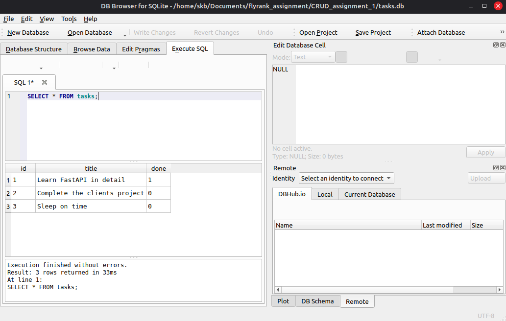
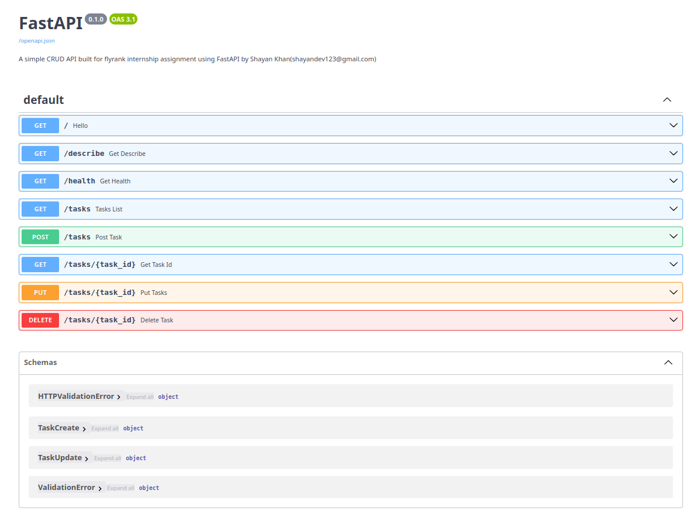
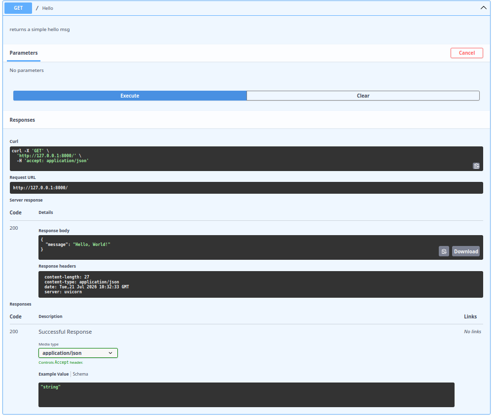
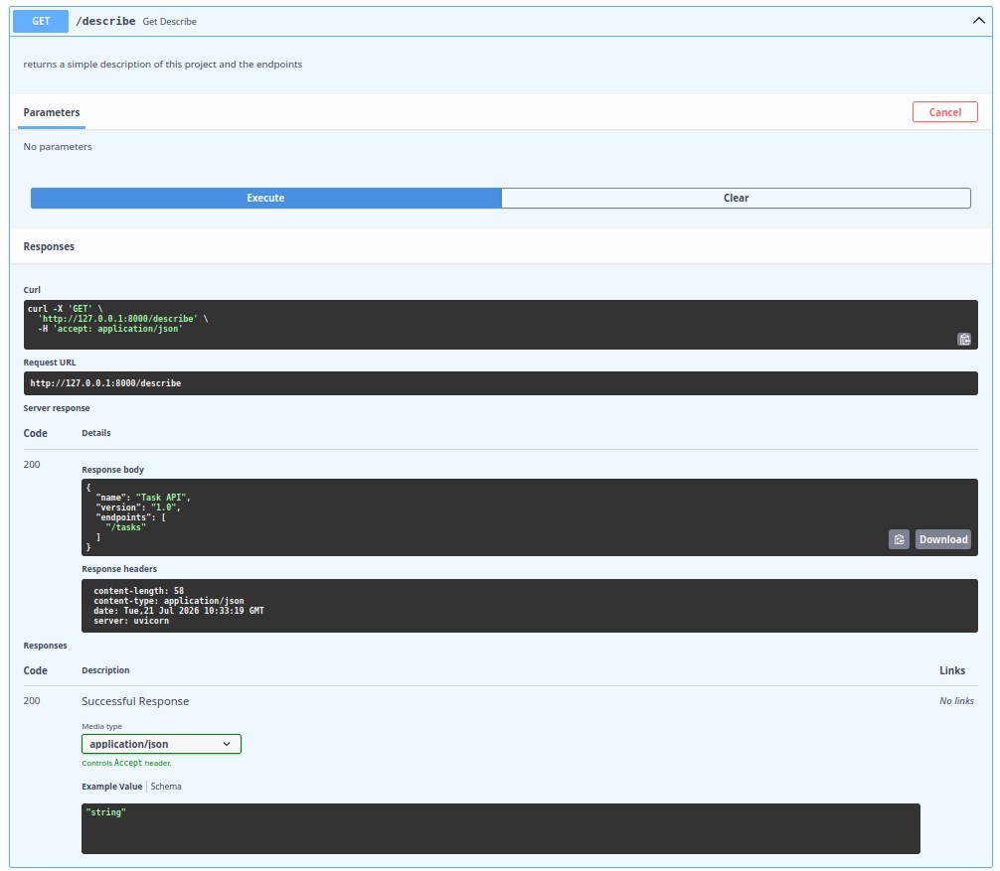
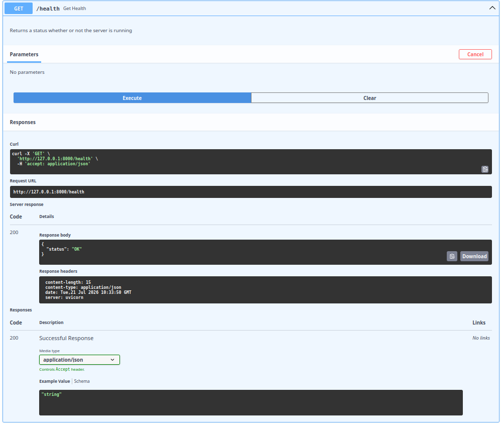
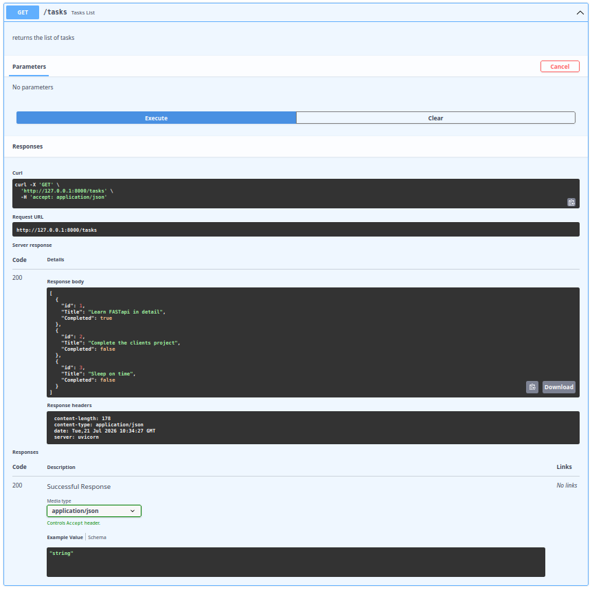
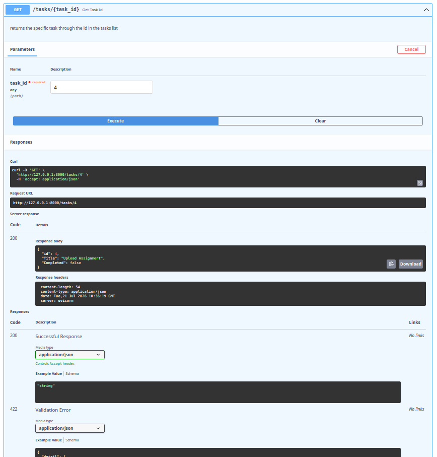
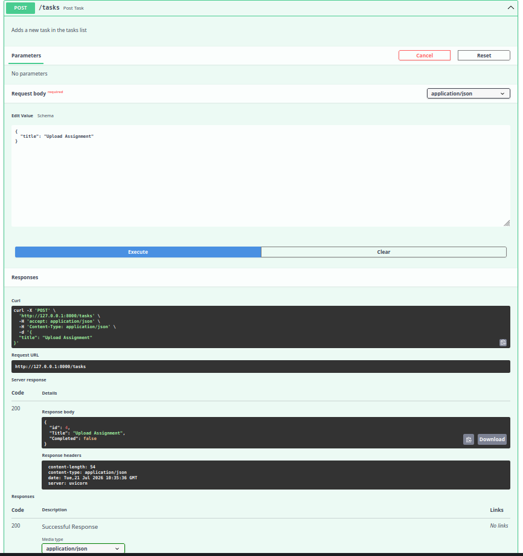
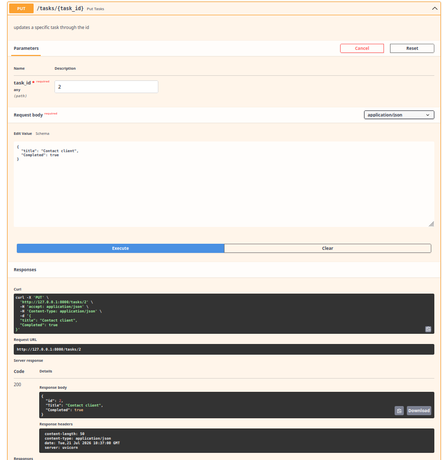

# Task API - FastAPI CRUD

A simple CRUD (Create, Read, Update, Delete) REST API built with FastAPI for the FlyRank Backend Assignment.

*Update: This API has been upgraded from an in-memory array to a persistent SQLite database.*

## Features

- Create a task
- View all tasks
- View a single task
- Update a task
- Delete a task
- Interactive Swagger documentation
- **Data persistence with SQLite** (Data survives server restarts)

---

## Database Architecture (Week 3 - Part 2)

- **Why SQLite?** SQLite was chosen because it is lightweight, requires no external server setup, and stores the entire database in a single local file. This makes it perfect for a beginner CRUD API while still teaching standard SQL syntax.
- **Storage Location:** The database is stored locally in a file named `tasks.db` in the root directory of the project.
- **Initialization:** The database and its tables are automatically created the first time the application runs. If the table is empty, it automatically seeds 3 example tasks.

### Database Viewer

Here is a look at the data directly inside DB Browser for SQLite:

(images/db_2.png)(images/db_3.png)(images/db_4.png)(images/db_5.png)

## Swagger UI

